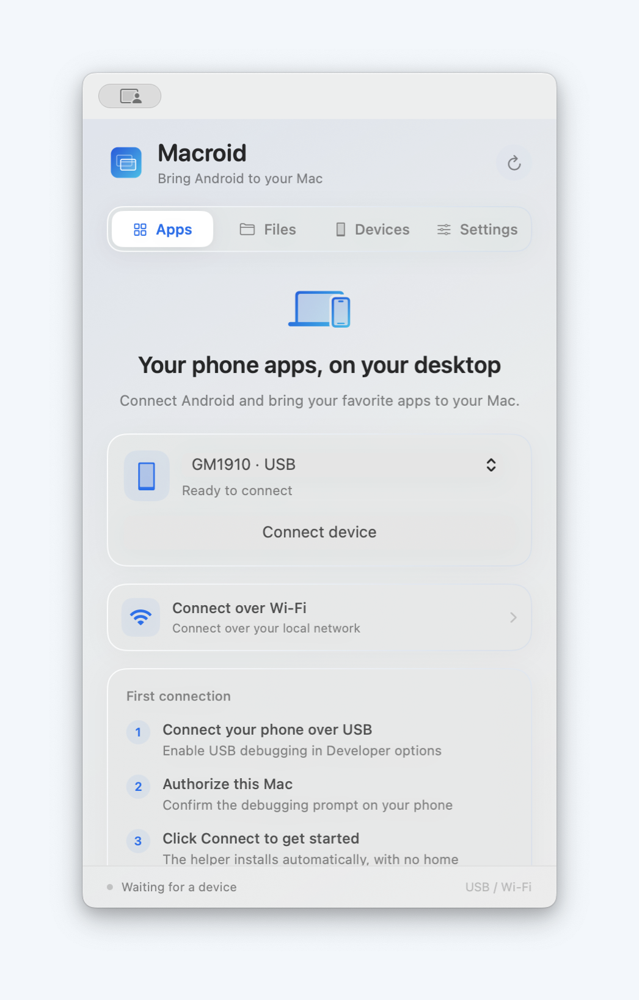
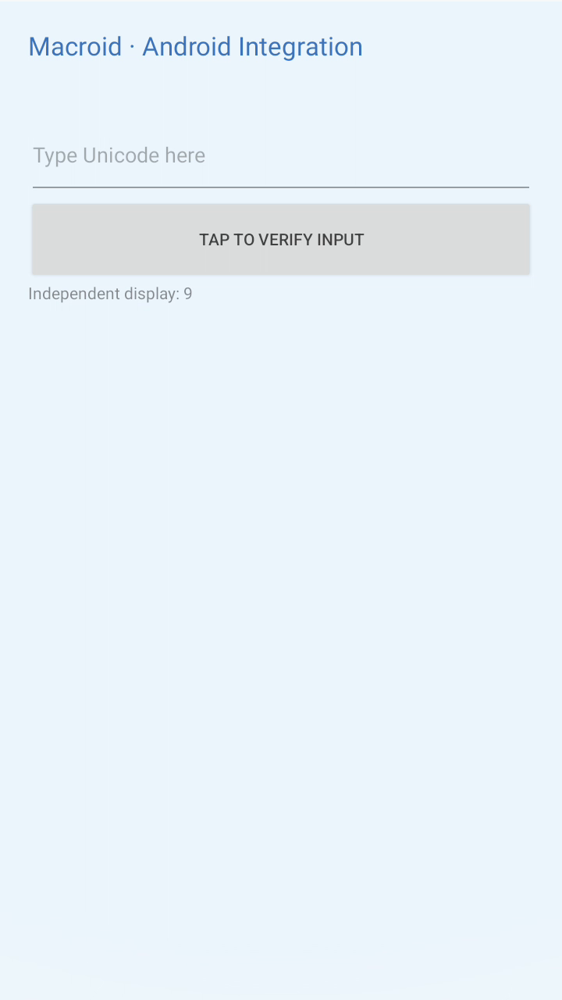

# Macroid

[简体中文文档](README.md)

Bring Android apps to separate native macOS windows. Macroid uses its own package name and wire protocol and connects to Android over ADB. It does not depend on the AndroMeld APK, account, server, or private protocol.

> **AI-assisted development:** OpenAI GPT assisted with most of the code, documentation, build scripts, and tests. The results were reviewed against local builds, emulators, and real-device connections. This is an experimental open-source project. Read the limitations and license before use.



## Features

- Native SwiftUI and AppKit windows on macOS 13+, with Universal 2 support for Intel and Apple Silicon.
- An Android 12 / API 31+ helper named `io.macroid.bridge`. It has no launcher activity or home-screen icon.
- An ADB-forwarded local Unix socket using the Macroid Wire v1 protocol. Each session gets a random authentication token.
- USB and Android wireless debugging connections, with up to four separate app windows at once.
- H.264 mirroring, pointer and scroll input, Android navigation keys, Unicode text input, file browsing, and chunked transfers.
- Resizable fusion windows without a phone frame. Android apps receive the actual dp dimensions and choose their own layout.
- Display-matched pixel density by default and a lower-resolution compatibility option. Phone mirroring follows device rotation and has a rotation control.
- Per-window always-on-top state. Supported devices can turn off the physical phone display while remaining connected; the last window closing restores it.
- A monochrome menu bar item for connecting and disconnecting, opening the main panel, mirroring the phone, restoring windows, and controlling screen power.
- Simplified Chinese and English UI. The app can follow the Mac's preferred language or use an explicit in-app language selection; the choice takes effect immediately and persists across launches.

Read the English [architecture](docs/ARCHITECTURE.en.md), [test log](docs/TESTING.en.md), [protocol specification](protocol/macroid-v1.en.md), and [third-party notices](THIRD_PARTY_NOTICES.en.md).

## Download and install

The current version is **0.3.0**. The latest `main` build includes the interface update, fusion quality controls, and mirroring rotation. Earlier snapshots are available at the [`0.3` tag](https://github.com/young4983/Macroid/tree/0.3). Macroid requires macOS 13+ and Android 12+. The Mac package supports Intel and Apple Silicon.

- [Download the Mac DMG](https://github.com/young4983/Macroid/raw/refs/heads/main/artifacts/Macroid-macOS-universal.dmg)
- [Download the Mac ZIP](https://github.com/young4983/Macroid/raw/refs/heads/main/artifacts/Macroid-macOS-universal.zip)
- [Download the optional Android helper APK](https://github.com/young4983/Macroid/raw/refs/heads/main/artifacts/Macroid.apk) (the Mac app can install it automatically)
- [SHA256SUMS checksums](https://github.com/young4983/Macroid/raw/refs/heads/main/artifacts/SHA256SUMS)

### First launch

1. Open the DMG and drag `Macroid.app` into the adjacent `Applications` folder, then launch it from Applications. For the ZIP, extract it first.
2. The Mac app bundles ADB and the Android helper. Android Studio and the Android SDK are not needed for normal use.
3. Enable USB debugging in the phone's Developer options, connect it to the Mac, and approve the debugging prompt.
4. Select the device in Macroid or its menu bar item and connect. Macroid installs the helper; there is no phone app to open manually.

To install the helper manually, run `adb install -r Macroid.apk`. Release files and checksums are kept in [`artifacts/`](artifacts/).

The macOS app uses a local ad-hoc signature. It is not Developer ID signed or notarized by Apple. If macOS cannot verify the developer on first launch, Control-click the app in Finder and choose **Open**, or allow it under **System Settings → Privacy & Security**. The Android APK is signed with a local development key.

### Updating an installation

1. Choose **Quit Macroid** from the menu bar item or press `⌘Q`. Closing the main panel does not quit the app. A normal quit disconnects devices and restores the phone display and keyboard state controlled by the session.
2. Open the new DMG, or extract the ZIP, and replace the old app in Applications. Do not run both versions at once.
3. Launch Macroid and reconnect. The app updates the bundled Android helper in place; normally, there is no need to uninstall it.
4. Favorites, fusion window positions and sizes, and always-on-top preferences are retained. **Keep phone screen off** must be enabled again after each connection. Open **About Macroid** from the menu bar to see the app version.

There is no automatic updater; download and replace the app manually. If macOS asks for launch approval again, follow the first-launch instructions above.

### Version 0.3

- Fusion windows use native macOS chrome and can be resized freely. Android apps receive an updated secondary-display size and choose whether to switch to a tablet layout.
- During resize, the old frame stays visible until the new frame is ready. Display IDs are retained, and encoder failures attempt recovery.
- Added device-level **Keep phone screen off** and per-window always-on-top controls. The screen is restored at session end, disconnect, or an Android agent failure.
- Added a menu bar entry for device connection, the main panel, phone mirroring, open windows, screen power, Settings, and Help. Selecting a device immediately shows connection progress in the main panel.
- Core functionality has been verified on real Android 12 and Android 16 devices. See the [test log](docs/TESTING.md) for scope and known limitations.

## Using Macroid

1. Open Macroid and connect an Android phone over USB. The phone must run Android 12 or later with USB debugging enabled.
2. Approve **Allow USB debugging** on the phone, then select the device in the **Devices** tab. You can also choose a device from the menu bar item; Macroid opens the main panel and starts connecting.
3. Select an app in **Apps** to open it in its own window. Choose **Phone screen** to mirror the phone's main display.
4. Drag a fusion window edge to change the app's display layout. **More actions** contains **Always on top** and **Keep phone screen off**. Screen power applies to every window for the device. Unlock the phone before turning its display off. Whether an app provides a tablet layout is up to that app.
5. To enter Chinese or other Unicode text, enable Macroid Keyboard in the mirror or app window toolbar. On normal disconnect or quit, Macroid restores the previous keyboard.

Macroid remains available from the menu bar after its main panel closes and continues refreshing the device list. Choose **Quit Macroid** from that menu to end the session and exit.

When connected, the menu bar shows the device name and provides a disconnect option. **Open windows** restores an existing minimized app window. The **Keep phone screen off** switch is shared between the menu and the mirror window.

To connect wirelessly, open **Devices → Wi-Fi connection** and pair with the code shown in Android Wireless debugging. Wireless debugging does not take over an active USB session; disconnect first, then select the wireless device.

## Screenshots



## Implemented functionality

| Area | Status |
| --- | --- |
| USB / wireless debugging | Device discovery, pairing-code setup, paired-device connection, and connection type display |
| Separate app windows | Independent virtual display, H.264 stream, and input target per window; the same app reuses its window |
| Resizable fusion window | No phone frame, native title bar, free aspect ratio, dynamic secondary display; Android apps control their own layout |
| Fusion quality | Match the display pixel ratio by default; choose compatibility resolution per app without changing logical layout size |
| Rotation | Phone mirroring follows device orientation; toolbar and More actions rotate by 90 degrees or enable auto-rotate |
| Always on top | Independent per window and persisted by app or mirror window |
| Physical display power | Turn off the panel while retaining video and input; capability detection, restore on exit, and a recovery guard for agent failure |
| Multiple windows | Up to four; actual capacity depends on phone encoders and app limitations |
| Android 12 / 13 | Dedicated compatibility display configuration without Android 14's independent-focus flag |
| Android 14+ | Per-display focus where supported; OEM differences still apply |
| Phone screen mirroring | SurfaceControl on Android 12 / 13; display mirroring interface on Android 14+ |
| Input | Pointer, drag, scroll, back, navigation keys, and editing shortcuts |
| Chinese / Unicode | macOS input-method composition and text submission through Macroid IME; enabling the IME requires user confirmation |
| Files | Shared-storage browser, chunked upload/download, progress and cancellation; refuses to overwrite a phone file with the same name |
| macOS UI | Compact native panel, segmented navigation, app grid, search, favorites, separate windows, files, and settings |
| Menu bar | Connect/disconnect, main panel, mirroring, window restore, screen power, settings, and quit |
| Encoder compatibility | Inspect encoder capabilities, reduce frame rate or resolution, try a fallback encoder, and keep diagnostics |

## Current limitations

- Android 12 / 13 secondary displays usually cannot get trusted-display permission. Focus, IME, and lock-screen isolation are weaker than on newer systems. Separate display support does not guarantee complete input isolation from the phone.
- Android launch modes can reuse or move a task already running on the phone. Macroid does not create an Android container, cloned account, or arbitrary app instances.
- Some apps forbid secondary displays or protected-video capture, and some vendor builds block features. Macroid does not bypass app security restrictions.
- Audio, notification sync, cross-device drag and drop, Mac camera/microphone mapping, automatic clipboard sync, and seamless USB/Wi-Fi migration are not implemented. The protocol reports audio and virtual-camera support as `false`.
- The current design targets the primary Android user and shared storage. Work profiles, secondary users, and foldable-device transitions need more testing.
- The arm64 build cross-compiles successfully. Release runtime testing has primarily used an Intel Mac; Apple Silicon hardware coverage is limited.

## Project layout

```text
Macroid/
├── macos/                    Native Mac app, Swift source, and tests
├── android/                  Android helper and integration-test fixture
├── protocol/macroid-v1.md    Macroid Wire v1 specification
├── scripts/                  Build, packaging, and integration-test scripts
├── docs/                     Architecture, test log, and screenshots
└── artifacts/                Release APK, Universal 2 DMG/ZIP, and checksums
```

## Build from source

Requirements: Xcode 26.1.1 (or compatible), Swift 6, JDK 21, Android SDK 36, Gradle 8.14.2, and `platform-tools`. The Android SDK is read from `$ANDROID_HOME` or `~/Library/Android/sdk`.

```bash
./scripts/build.sh
./scripts/package.sh
```

The build first compiles the Android APK, then bundles the APK, Universal ADB, and third-party notices in the Mac app, and builds a Universal 2 `.app` for x86_64 and arm64 with a local ad-hoc signature. The packaging script checks the signature and bundled APK, then creates a DMG with an Applications shortcut, a ZIP, a source archive, and updated `artifacts/SHA256SUMS` entries.

Build either component separately:

```bash
./scripts/build-android.sh
./scripts/build-macos.sh
```

After the first build, open `android/` in Android Studio or `macos/Macroid.xcodeproj` in Xcode. After changing the phone-side source, run the full build again so the Mac app contains the matching APK.

## Verification

```bash
swift test --package-path macos
cd android
./gradlew :app:lintDebug :app:assembleDebug :fixture:assembleDebug
cd ..
python3 scripts/smoke-android.py --serial emulator-5580 --output artifacts/testing/android31
```

Integration tests require an explicit emulator serial and reject physical devices by default. Do not let another Macroid session use the same emulator. Run the Mac client's real connection and video-decoding test with:

```bash
artifacts/Macroid.app/Contents/MacOS/Macroid \
  --integration-test emulator-5580 \
  --integration-output /absolute/path/to/macroid-test-output
```

For more detail, see [architecture](docs/ARCHITECTURE.en.md), the [protocol specification](protocol/macroid-v1.en.md), the [test log](docs/TESTING.en.md), and [third-party notices](THIRD_PARTY_NOTICES.en.md).

## License

Macroid is licensed under the [MIT License](LICENSE). Third-party component copyright and license details are in [THIRD_PARTY_NOTICES.md](THIRD_PARTY_NOTICES.md).
