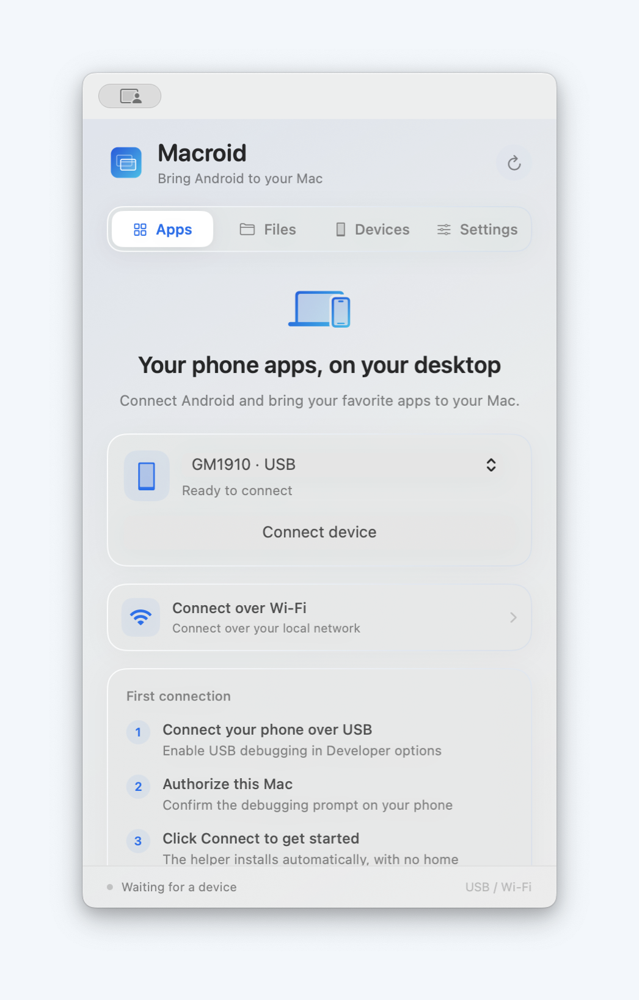
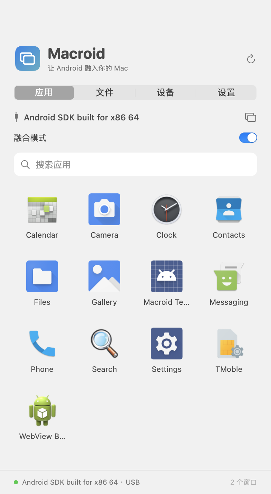
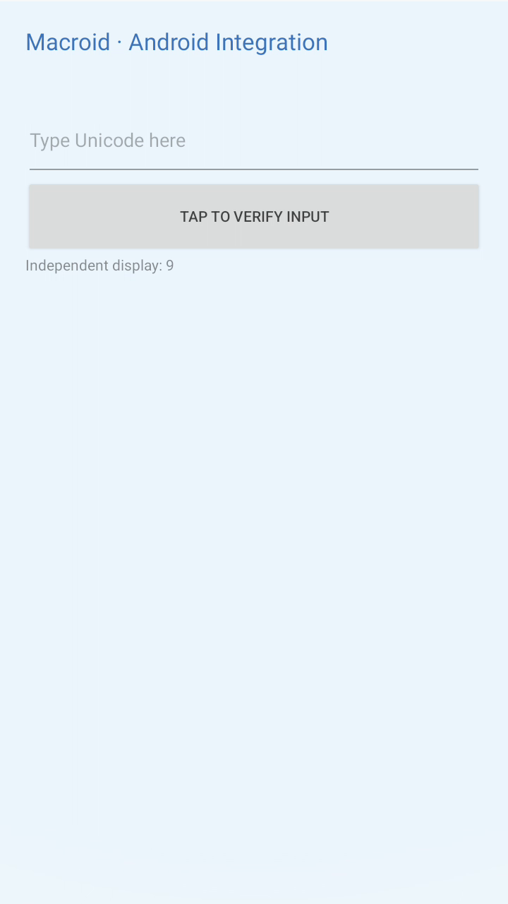

# Macroid

把 Android 应用带进独立的 macOS 窗口。Macroid 使用独立包名和自有通信协议，通过 ADB 连接 Android 设备，不依赖 AndroMeld APK、账号、服务器或私有协议。

> **AI coding（GPT）产物声明**：本项目的代码、文档、构建脚本和测试整理主要由 OpenAI GPT 辅助生成与迭代，随后结合本地编译、模拟器和真机连接结果进行人工复核。它是一个公开的实验性开发项目，使用前请先阅读当前边界与许可说明。



## 特性

- macOS 原生 SwiftUI / AppKit 窗口，支持 macOS 13+ 和 Universal 2（Intel x86_64 + Apple Silicon arm64）。
- Android 12 / API 31+ 助手，包名为 `io.macroid.bridge`；助手没有 launcher Activity，不会额外显示桌面图标。
- 通过 ADB 转发本地 Unix socket，使用 Macroid Wire v1 协议；每次连接生成新的随机认证令牌。
- USB 和 Android 无线调试连接，最多同时打开四个独立应用窗口。
- H.264 投屏、点击/拖动/滚轮/返回/导航键、中文和 Unicode 输入、文件浏览与分块传输。
- 融合窗口无手机外壳，可自由调整宽高；应用按 Android 实际 dp 尺寸自行切换布局。
- 每个窗口独立记住置顶状态；支持的设备可关闭手机物理屏幕继续操作，最后一个窗口关闭时恢复。

## 下载与安装

仓库中的 `artifacts/` 目录包含当前版本的可直接使用产物：

- [Macroid-macOS-universal.zip](artifacts/Macroid-macOS-universal.zip)：Universal 2 macOS 应用，解压后将 `Macroid.app` 拖到“应用程序”。
- [Macroid.apk](artifacts/Macroid.apk)：Android 12+ 助手 APK。正常使用时由 Mac 应用自动安装；也可以通过 `adb install -r Macroid.apk` 手动安装。
- [SHA256SUMS](artifacts/SHA256SUMS)：上述发布文件的 SHA-256 校验值。

macOS 应用使用本地 ad-hoc 签名，没有 Developer ID 签名或 Apple 公证。首次打开时，如果系统提示无法验证开发者，请在 Finder 中右键点击应用并选择“打开”，或到“系统设置 → 隐私与安全性”允许打开。Android APK 使用本地开发密钥签名。

### 运行 Macroid

1. 打开 Macroid，将 Android 手机通过 USB 连接到 Mac；手机需运行 Android 12 或更高版本，并在开发者选项中开启 USB 调试。
2. 在手机上确认“允许这台电脑进行 USB 调试”，回到 Macroid 的“设备”页选择设备并连接。
3. 在“应用”页点击应用图标，它会在独立窗口中打开；“手机屏幕”可投屏手机主屏。
4. 拖动融合窗口边缘可调整应用布局；“更多操作”菜单包含“窗口置顶”和“关屏使用”。关屏前先在手机上解锁，开关作用于当前设备所有窗口。是否有平板布局由应用决定。
5. 中文输入时，在窗口右上角启用 Macroid 键盘。退出或正常断开连接时，Macroid 会恢复原输入法并释放虚拟显示。

也可以在“设备 → Wi-Fi 连接”中使用 Android 无线调试的配对码配对设备。无线连接不会自动接管已有 USB 会话，需要先断开后重新选择 Wi-Fi 设备连接。

## 截图





## 已实现功能

| 功能 | 状态 |
| --- | --- |
| USB / 无线调试 | 设备发现、配对码配对、已配对设备连接和连接方式提示 |
| 独立应用窗口 | 每个窗口使用独立虚拟显示、H.264 流和输入目标；相同应用复用窗口 |
| 自适应融合窗口 | 无手机外壳、原生标题栏、自由比例、动态副屏尺寸和视频转场；布局由 Android 应用决定 |
| 窗口置顶 | 每窗口独立切换，按应用或镜像窗口保存 |
| 关屏使用 | 物理面板关闭，保留编码和输入；按设备探测、退出恢复，独立守护处理 agent 异常退出 |
| 多窗口 | 最多四个；实际数量取决于手机编码器和应用限制 |
| Android 12/13 | 单独的兼容显示配置，不依赖 Android 14 的独立焦点标志 |
| Android 14+ | 开启每显示器独立焦点，仍需考虑厂商差异 |
| 手机主屏投屏 | Android 12/13 使用 SurfaceControl；Android 14+ 使用显示镜像接口 |
| 输入 | 点击、拖动、滚轮、返回、导航键和编辑快捷键 |
| 中文 / Unicode | Mac 系统输入法组合文字，Android Macroid IME 提交文本；启用时需要用户确认 |
| 文件 | 浏览共享存储、分块上传/下载、进度与取消；拒绝覆盖同名手机文件 |
| macOS UI | 原生窄面板、分段导航、应用图标网格、搜索、收藏、独立窗口、文件与设置 |
| 编码兼容 | 查询编码器能力，自动降低帧率/分辨率，提供备用编码器和持久诊断 |

## 当前边界

- Android 12/13 的副屏通常无法获得可信显示权限，焦点、输入法和锁屏隔离不如新系统。支持独立显示，不保证手机和电脑输入完全互不影响。
- 应用的启动模式可能复用或迁移手机上的已有任务。Macroid 不创建 Android 容器、克隆账号或任意应用多实例。
- 部分应用禁止副屏、受保护视频捕获或被厂商系统拦截；Macroid 不绕过应用的安全限制。
- 当前尚未实现音频、通知同步、跨端文件拖放、电脑摄像头/麦克风映射、自动剪贴板同步和 USB/Wi-Fi 无缝迁移。协议会明确报告音频和虚拟摄像头能力为 `false`。
- 当前按设备主用户的共享存储设计；工作资料、其他用户和折叠屏切换仍需要更多测试。
- arm64 版本已完成交叉编译；发布前的 Mac 运行测试使用 Intel，Apple Silicon 实机覆盖仍有限。

## 项目结构

```text
Macroid/
├── macos/                    原生 Mac 应用、Swift 源码与测试
├── android/                  Android 助手和集成测试 fixture
├── protocol/macroid-v1.md    Macroid Wire v1 协议规范
├── scripts/                  构建、打包和集成测试脚本
├── docs/                     架构、验证记录和截图
└── artifacts/                发布 APK、Universal 2 应用压缩包和校验值
```

## 从源码构建

环境要求：Xcode 26.1.1（或兼容版本）、Swift 6、JDK 21、Android SDK 36、Gradle 8.14.2 和 `platform-tools`。Android SDK 默认从 `$ANDROID_HOME` 或 `~/Library/Android/sdk` 读取。

```bash
./scripts/build.sh
./scripts/package.sh
```

构建脚本会先编译 Android APK，再把 APK、Universal ADB 和第三方声明放入 Mac 应用，最后构建包含 x86_64 与 arm64 的 `.app` 并进行本地 ad-hoc 签名。构建完成后，`scripts/package.sh` 会更新 `artifacts/Macroid-macOS-universal.zip`、`artifacts/Macroid.apk` 和 `artifacts/SHA256SUMS`。

也可以分别运行：

```bash
./scripts/build-android.sh
./scripts/build-macos.sh
```

首次构建后，可在 Android Studio 打开 `android/`，或在 Xcode 打开 `macos/Macroid.xcodeproj`。更新手机端源码后，需要重新执行完整构建，确保 Mac 应用内置 APK 与源码一致。

## 验证

```bash
swift test --package-path macos
cd android
./gradlew :app:lintDebug :app:assembleDebug :fixture:assembleDebug
cd ..
python3 scripts/smoke-android.py --serial emulator-5580 --output artifacts/testing/android31
```

集成测试必须明确指定模拟器序列号，默认拒绝对真机运行。不要让另一个 Macroid 会话同时使用同一模拟器。Mac 客户端真实连接和解码测试可以这样运行：

```bash
artifacts/Macroid.app/Contents/MacOS/Macroid \
  --integration-test emulator-5580 \
  --integration-output /absolute/path/to/macroid-test-output
```

更多设计与验证信息见 [架构说明](docs/ARCHITECTURE.md)、[协议规范](protocol/macroid-v1.md)、[验证记录](docs/TESTING.md) 和 [第三方声明](THIRD_PARTY_NOTICES.md)。

## 许可证

Macroid 使用 [MIT License](LICENSE)。第三方组件的版权和许可证见 [THIRD_PARTY_NOTICES.md](THIRD_PARTY_NOTICES.md)。
